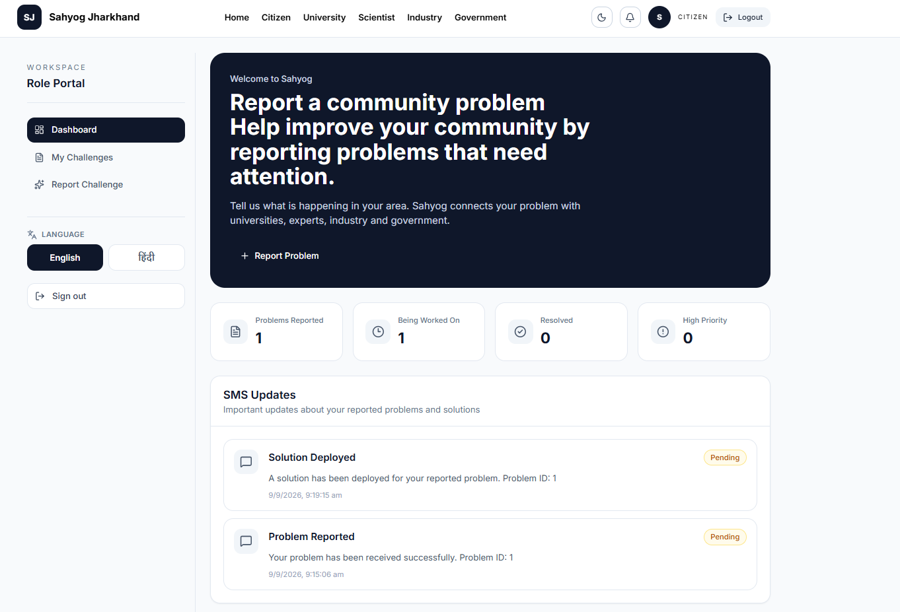
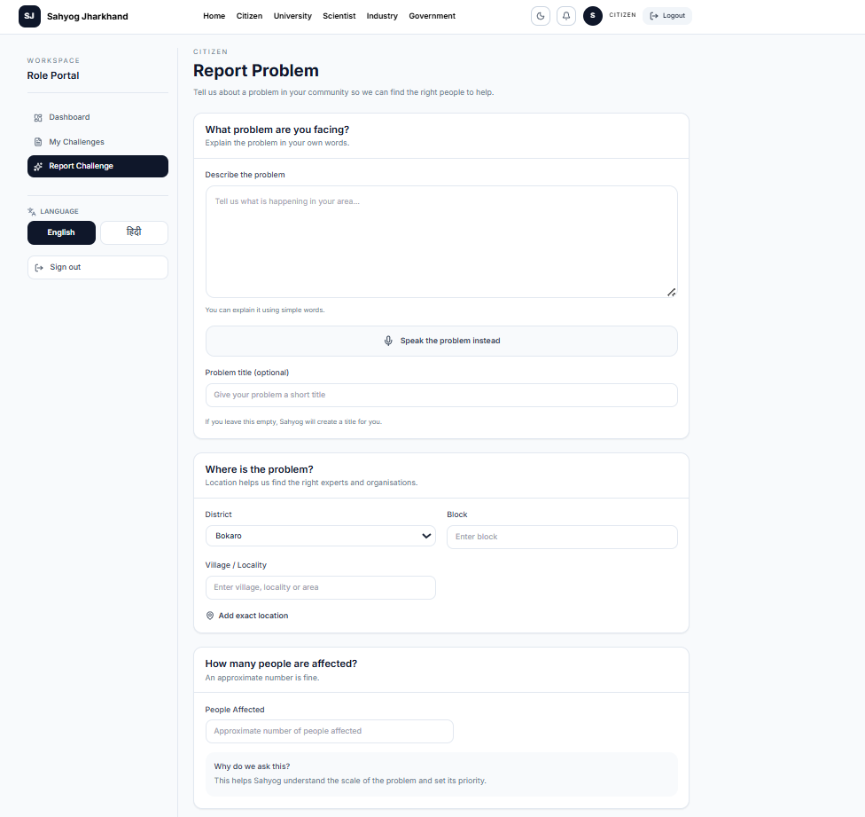
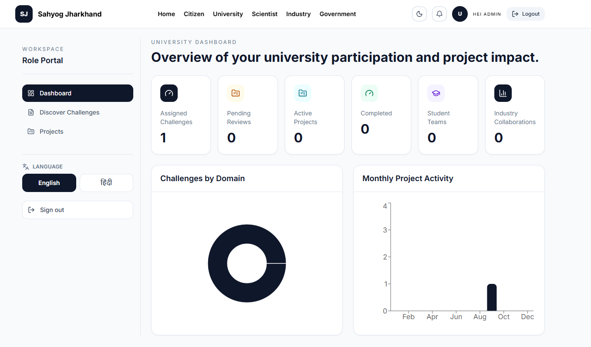
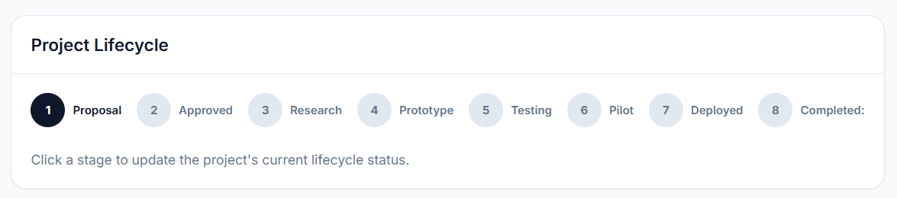
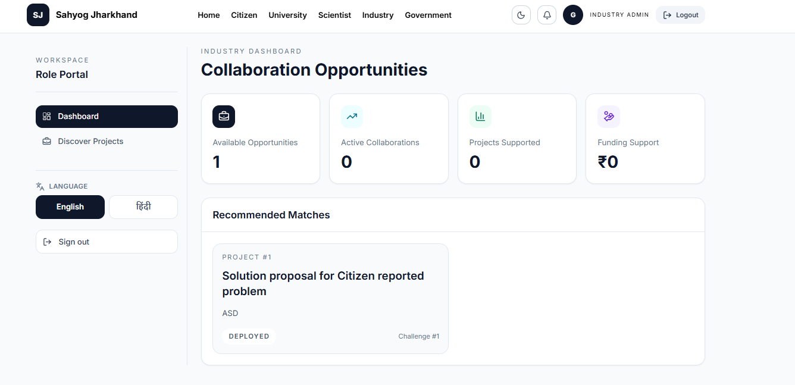
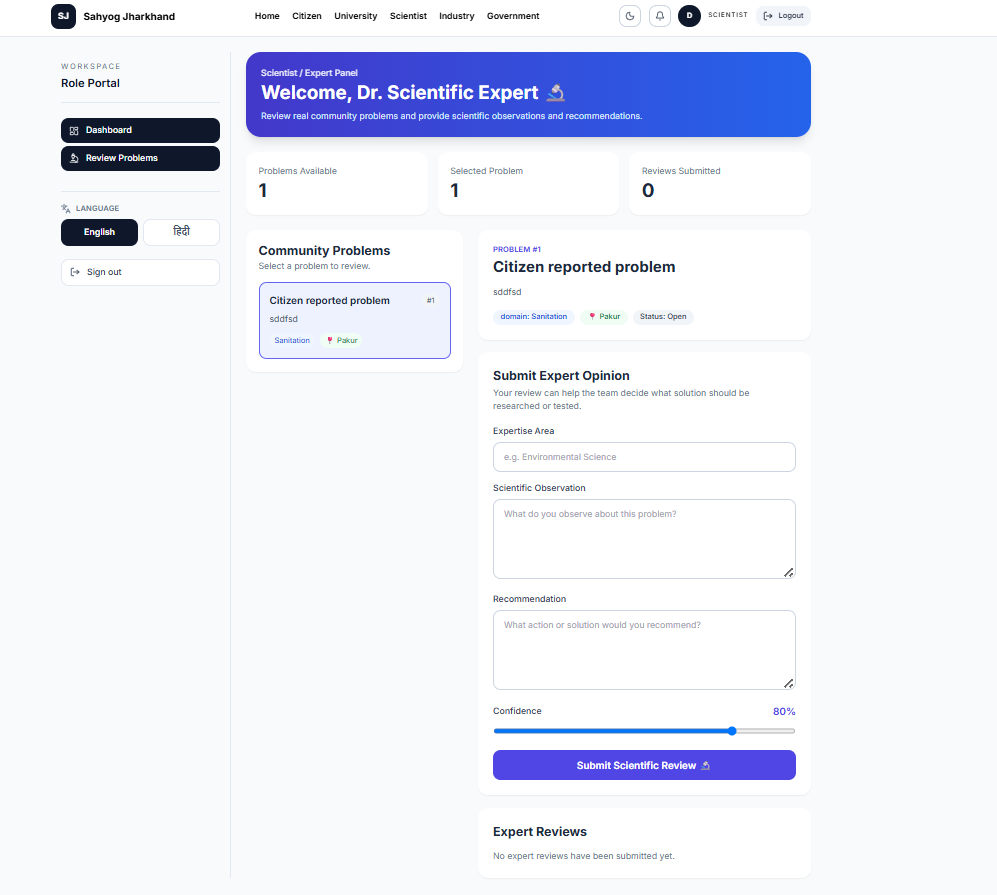
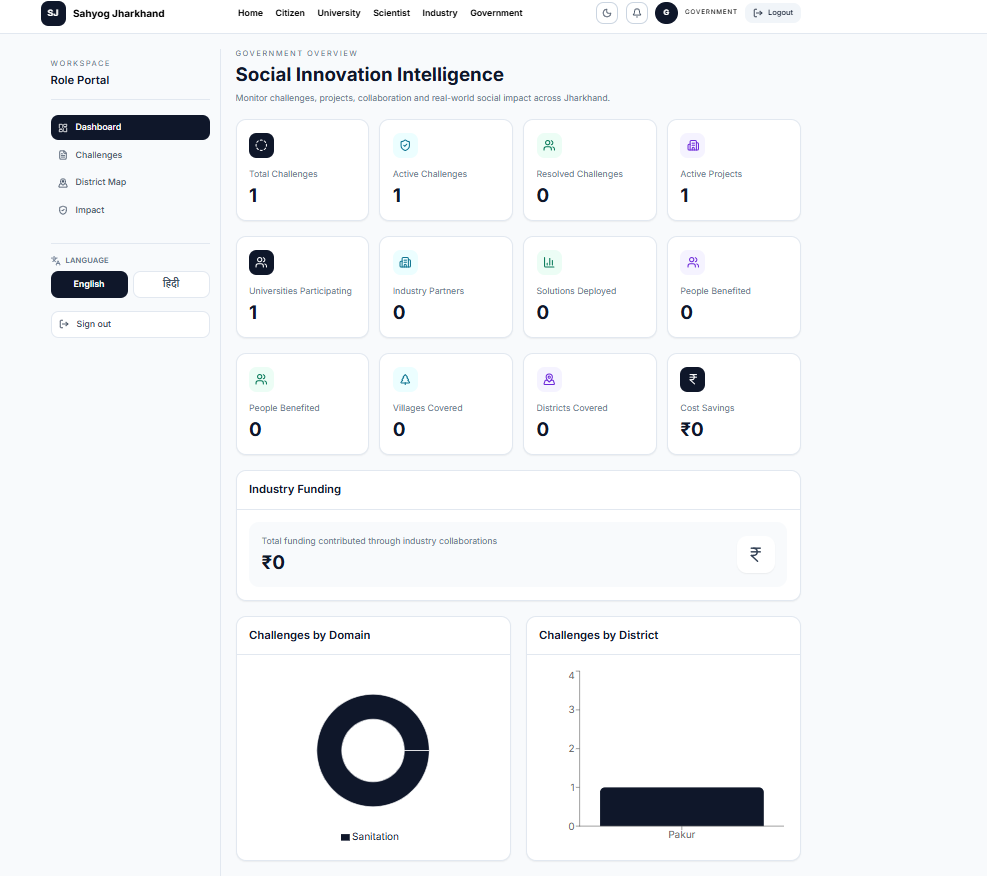
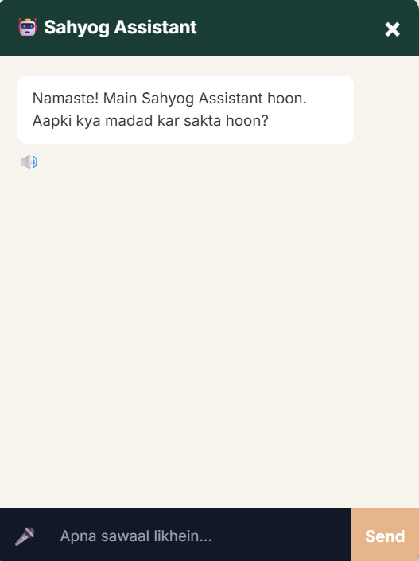

# 🇮🇳 Sahyog Jharkhand

### AI-Powered Societal Problem Solving & Collaboration Platform

**Sahyog Jharkhand** is a digital platform that connects **citizens, universities, faculty, students, scientists, industries, and government authorities** around real-world societal problems.

Instead of stopping at problem reporting, Sahyog creates an end-to-end workflow:

> **Citizen reports a problem → AI understands and prioritizes it → the right university and experts are matched → students research and build solutions → industry supports testing and deployment → impact is measured → government monitors progress → citizens receive updates.**

---

## 🎯 Problem

Societal problems are often reported, but the process after reporting is fragmented.

A citizen may report a problem, but:

- the right organization may not receive it
- experts may not be identified
- students and researchers may not get connected to real problems
- industries may not know where their resources can help
- government may lack a unified monitoring system
- citizens may not know what happened after reporting

**Sahyog Jharkhand connects these stakeholders into one collaborative workflow.**

---

## 💡 Solution

Sahyog transforms a citizen-reported problem into a structured, trackable solution pipeline.

```text
Citizen
   ↓
Problem Report
   ↓
AI Analysis
   ↓
Priority + Domain Classification
   ↓
University Matching
   ↓
Faculty / Scientist Matching
   ↓
Student Team
   ↓
Research
   ↓
Prototype
   ↓
Industry Collaboration
   ↓
Testing
   ↓
Pilot
   ↓
Deployment
   ↓
Impact Measurement
   ↓
Government Monitoring
   ↓
Citizen Notification
```

---

# 🚀 Key Features

## 👤 Citizen Platform

Citizens can:

- Register and securely log in
- Report societal problems
- Select district, block and locality
- Share their location
- Enter the number of people affected
- Use voice input to report problems
- Submit problems in **English or Hindi**
- Track reported problems
- View AI analysis
- View matched universities
- View matched faculty
- View scientist observations
- Validate problems reported by others
- Receive problem and solution notifications
- Interact with the Sahyog AI chatbot

### Community Impact Validation

Citizens can validate whether they are affected by a reported problem:

```text
Is this problem affecting you?

👍 Yes — 1,250
👎 No  — 43
```

The platform calculates a **community validation score** based on citizen responses.

This provides an additional signal for understanding whether a reported problem is actually affecting the community.

---

## 🤖 AI-Powered Problem Understanding

The platform uses AI to assist with problem analysis.

AI can help determine:

- Problem domain
- Severity
- Urgency
- Geographic impact
- Similar/duplicate problems
- Relevant universities
- Relevant faculty
- Relevant expertise

The system uses **explainable matching**, so users can understand why an institution or expert was recommended.

AI is also used for:

- English ↔ Hindi translation
- Conversational assistance through the Sahyog chatbot

---

# 🏫 University & Faculty Collaboration

Universities can discover and work on problems relevant to their expertise.

The platform supports:

- University matching
- Faculty matching
- Faculty mentorship
- Student teams
- Project proposals
- Project members
- Tasks
- Milestones
- Deliverables
- Project lifecycle tracking

Faculty can guide student teams from research through deployment.

---

# 🔬 Scientist Review

Sahyog includes a dedicated **Scientist role**.

Scientists can review reported societal problems and provide:

- Observations
- Recommendations
- Confidence level
- Expertise area

This adds an expert validation layer between AI-generated analysis and real-world problem solving.

---

# 🏭 Industry Collaboration

Industry partners can collaborate with university projects.

Supported collaboration types:

- 💰 Funding
- 🧑‍🏫 Mentorship
- 🛠️ Prototyping
- 🧪 Testing
- 🚀 Pilot
- 🌐 Deployment

Collaboration statuses include:

```text
PENDING
ACCEPTED
IN_PROGRESS
COMPLETED
REJECTED
```

Funding and collaboration information can be tracked as part of the project.

---

# 📊 Project Impact Measurement

Once a solution is deployed, its impact can be recorded.

The platform supports tracking:

- People benefited
- Villages covered
- Districts covered
- Cost savings
- Environmental impact
- Outcome
- Deployment status

This helps move the platform from simply tracking **projects** to measuring their **real-world impact**.

---

# 🏛️ Government Monitoring

Government users have access to a dedicated monitoring dashboard.

### Challenge Analytics

- Total challenges
- Active challenges
- Resolved challenges
- Challenge domains
- Challenge status
- Geographic challenge distribution

### Project Analytics

- Total projects
- Active projects
- Completed projects
- Project lifecycle status

### Participation

- Universities participating
- Industry partners
- University participation
- Industry participation

### Impact

- Solutions deployed
- People benefited
- Villages covered
- Districts covered
- Total funding

Government users can therefore monitor the overall ecosystem rather than handling individual reports separately.

---

# 🔄 Complete Project Lifecycle

One of the core features of Sahyog is its structured project lifecycle.

Every solution project can move through the following stages:

```text
PROPOSAL
   ↓
APPROVED
   ↓
RESEARCH
   ↓
PROTOTYPE
   ↓
TESTING
   ↓
PILOT
   ↓
DEPLOYED
   ↓
COMPLETED
```

### 1. Proposal

A university/team proposes a solution for a societal problem.

### 2. Approved

The proposal is accepted and the project officially begins.

### 3. Research

Students, faculty and researchers study the problem and develop the required approach.

### 4. Prototype

The team creates an initial working solution.

### 5. Testing

The solution is tested to identify issues and verify whether it works as expected.

### 6. Pilot

The solution is deployed on a limited scale in the target community.

### 7. Deployed

The solution is deployed for actual real-world use.

### 8. Completed

The project reaches completion after implementation and impact evaluation.

---

# 👥 Project Execution

Each project can contain:

### Members

- Faculty mentor
- Students
- Other authorized participants

### Tasks

Tasks can be assigned to project members and tracked through their progress.

### Milestones

Projects can be divided into measurable milestones.

### Deliverables

Teams can submit deliverables for review.

Supported deliverable statuses:

```text
PENDING
SUBMITTED
APPROVED
REJECTED
```

This provides a structured workflow instead of simply storing project information.

---

# 🌐 Multilingual Support

Sahyog supports:

🇬🇧 **English**

🇮🇳 **Hindi**

Multilingual support is available across major parts of the platform.

Citizen problem reports can also be submitted in Hindi.

The system stores:

- Original language
- English translation
- Hindi translation

AI processing uses the English representation where required, while the original language is preserved for the citizen.

This helps make the platform more accessible to users who are more comfortable communicating in Hindi.

---

# 🗣️ Voice-Based Problem Reporting

Citizens can use browser-based speech recognition to report problems.

Example:

> "Hamare gaon mein peene ke paani ki bahut problem hai."

The system can convert speech into text and use it as the problem description.

This reduces the need for citizens to type long descriptions.

---

# 🤖 Sahyog AI Chatbot

The platform includes an integrated **Sahyog AI assistant**.

The chatbot can help users understand:

- How Sahyog works
- How to report a problem
- Project progress
- Platform features
- General questions about the platform

The chatbot supports conversational interaction and voice input/output.

The current implementation uses a local **Ollama + Llama 3.2** setup.

---

# 📱 Citizen Notifications

Sahyog includes a notification workflow for important events.

### Problem Reported

After a citizen submits a problem, the system creates a notification such as:

> "Your problem has been received successfully."

### Solution Deployed

When the corresponding project reaches deployment:

> "A solution has been deployed for your reported problem."

The current implementation stores these notifications inside the platform and marks them as pending for external SMS delivery.

A production deployment can connect the same notification system to an SMS provider.

---

# 🔐 Security & Role-Based Access Control

Sahyog uses role-based access control to ensure that users can only access functionality appropriate to their role.

Supported roles include:

```text
CITIZEN
COMMUNITY_ORG
HEI_ADMIN
FACULTY
STUDENT
SCIENTIST
INDUSTRY_ADMIN
GOVERNMENT
SUPER_ADMIN
```

Examples:

- Citizens can manage their own reported problems.
- Students can access projects they are members of.
- Faculty can manage relevant university projects.
- Scientists can submit scientific reviews.
- Industry users can create industry collaborations.
- Government users can access government analytics.
- Administrative operations are protected separately.

The backend also validates ownership and organizational boundaries to prevent unauthorized cross-project or cross-user access.

---

# 🛡️ Backend Security

The backend includes:

- JWT authentication
- Protected API routes
- Role-based authorization
- Resource ownership checks
- HEI-level access restrictions
- Project membership validation
- Input validation
- Status validation
- Funding validation
- Duplicate vote prevention
- Protected government analytics
- Protected scientist review operations

The system was also tested against unauthorized access scenarios such as:

- Unauthenticated API access
- Citizen accessing another citizen's challenge
- HEI accessing another HEI's project
- Non-member student accessing project tasks
- Invalid industry collaboration access
- Invalid impact values
- Invalid project lifecycle transitions

---

# 📍 Data & Societal Problem Intelligence

Sahyog is designed to work with real-world societal data and geographic context.

Potential data domains include:

- 🌾 Agriculture
- 💧 Water Management
- 🏥 Healthcare
- 🎓 Education
- 🌳 Environment

Government/open datasets can provide measurable evidence, while geographic sources such as OpenStreetMap can provide contextual information about infrastructure and locations.

The platform can therefore combine:

```text
Citizen Reports
       +
AI Analysis
       +
Government/Open Data
       +
Geographic Context
       +
Expert Validation
```

to improve problem understanding and prioritization.

---

# 🗺️ Example End-to-End Scenario

### Step 1 — Citizen

A citizen reports:

> "There is no reliable drinking water supply in our village."

The citizen can submit the problem using text or voice.

### Step 2 — AI

Sahyog processes the report and identifies relevant information such as:

```text
Domain: Water Management
Severity: High
Urgency: High
Geographic Impact: Local
```

### Step 3 — Community Validation

Other citizens can indicate whether they are affected by the problem.

```text
👍 Yes — Affected
👎 No — Not affected
```

The resulting validation score provides an additional community-level signal.

### Step 4 — University Matching

The system identifies universities with relevant:

- Domains
- Faculty expertise
- Research capabilities
- Infrastructure
- Location relevance

### Step 5 — Faculty Matching

Relevant faculty members are recommended based on:

- Expertise
- Department
- Research areas
- Location
- Availability

### Step 6 — Scientist Review

A scientist can review the problem and provide an expert observation and recommendation.

### Step 7 — Student Team

A university creates a project and assigns:

- Faculty mentor
- Student members
- Tasks
- Milestones
- Deliverables

### Step 8 — Research

The team investigates the root cause and designs a solution.

### Step 9 — Prototype

A prototype is developed.

### Step 10 — Industry

An industry partner can provide:

- Funding
- Mentorship
- Prototyping
- Testing
- Pilot support
- Deployment support

### Step 11 — Testing

The solution is tested.

### Step 12 — Pilot

The solution is introduced to the target community on a limited scale.

### Step 13 — Deployment

The project moves to:

```text
DEPLOYED
```

### Step 14 — Impact

The project records:

```text
People Benefited
Villages Covered
Districts Covered
Cost Savings
Environmental Impact
Outcome
```

### Step 15 — Government

Government officials can monitor the project and its measurable impact.

### Step 16 — Citizen

The original citizen receives a notification that a solution has been deployed.

---

# 🖥️ Platform Screenshots

## 👤 Citizen Dashboard



The citizen dashboard provides problem reporting, problem tracking, statistics and notifications.

---

## 🗳️ Problem Detail & Community Validation



Citizens can view AI analysis, matched universities, faculty, scientist reviews and validate whether they are affected by the problem.

---

## 🏫 University Dashboard



Universities can discover societal problems and manage solution projects.

---

## 🔄 Project Lifecycle



Projects can be tracked through the complete lifecycle from proposal to deployment and completion.

---

## 🏭 Industry Dashboard



Industry partners can discover projects and provide different forms of support.

---

## 🔬 Scientist Dashboard



Scientists can review societal problems and provide expert observations and recommendations.

---

## 🏛️ Government Dashboard



Government officials can monitor challenges, projects, participation and measurable impact.

---

## 🤖 Sahyog AI Assistant



The integrated AI assistant helps users interact with and understand the platform.

---

# 🏗️ Technology Stack

## Frontend

- React
- Vite
- Tailwind CSS
- JavaScript
- React Router
- Context API
- Browser Speech Recognition
- Browser Speech Synthesis

## Backend

- Python
- FastAPI
- SQLAlchemy
- Alembic
- Pydantic
- JWT Authentication
- REST APIs

## Database

- PostgreSQL

## AI

- Ollama
- Llama 3.2
- AI-based problem classification
- AI-based university matching
- AI-based faculty matching
- AI-assisted translation
- AI chatbot

## Geospatial / Data Layer

- OpenStreetMap
- Government/Open datasets
- Location-based matching and context

---

# 📁 Project Structure

```text
Societal-Innovation-Portal/

├── backend/
│   ├── app/
│   │   ├── api/
│   │   ├── models/
│   │   ├── schemas/
│   │   ├── services/
│   │   └── main.py
│   │
│   ├── alembic/
│   ├── requirements.txt
│   └── .env.example
│
├── frontend/
│   ├── public/
│   ├── docs/
│   │   └── screenshots/
│   │       ├── challenge-detail-community-validation.png
│   │       ├── citizen-dashboard.png
│   │       ├── government-dashboard.png
│   │       ├── industry-dashboard.png
│   │       ├── project-lifecycle.png
│   │       ├── sahyog-ai-chatbot.png
│   │       ├── scientist-dashboard.png
│   │       └── university-dashboard.png
│   │
│   └── src/
│       ├── components/
│       ├── context/
│       ├── pages/
│       ├── services/
│       └── i18n/
│
└── README.md
```

---

# ⚙️ Local Setup

## Backend

```bash
cd backend
```

Create a Python virtual environment:

```bash
python -m venv venv
```

### Windows

```powershell
.\venv\Scripts\Activate.ps1
```

Install dependencies:

```bash
pip install -r requirements.txt
```

Configure the environment variables using `.env.example`.

Run database migrations:

```bash
alembic upgrade head
```

Start the backend:

```bash
uvicorn app.main:app --reload
```

Backend API:

```text
http://127.0.0.1:8000
```

---

## AI Setup

The chatbot and AI services use a local Ollama setup.

Required model:

```text
llama3.2:3b
```

Pull the model using Ollama:

```bash
ollama pull llama3.2:3b
```

---

## Frontend

```bash
cd frontend
npm install
npm run dev
```

The frontend will normally be available at:

```text
http://localhost:5173
```

---

# 🔑 Important Security Note

Environment files containing secrets are intentionally excluded from Git.

Do **not** commit:

```text
.env
```

Use:

```text
.env.example
```

as the configuration template.

---

# 🌱 Societal Impact

Sahyog is designed to create a bridge between different parts of society.

### Citizens

Get a structured way to report and track real problems.

### Universities

Can work on real-world problems instead of isolated academic projects.

### Students

Gain practical experience by building solutions for real communities.

### Faculty

Can guide research and innovation projects.

### Scientists

Can provide domain-level validation and recommendations.

### Industry

Can contribute funding, expertise, infrastructure and deployment support.

### Government

Can monitor problems, projects and measurable outcomes.

---

# 🔮 Future Expansion

Potential future integrations include:

- Real SMS gateway integration
- More Indian languages
- More government datasets
- Advanced geospatial analytics
- Automated impact verification
- Additional AI models
- Mobile application
- Advanced government monitoring
- Real-time deployment tracking
- Larger-scale district and state-level analytics

---

# 🎯 Vision

Sahyog is designed around one simple idea:

> **A reported problem should not end with a complaint. It should become a collaborative path toward a measurable solution.**

The platform connects:

```text
Citizens
   ↓
AI
   ↓
Universities
   ↓
Faculty
   ↓
Students
   ↓
Scientists
   ↓
Industry
   ↓
Government
   ↓
Measurable Impact
```

---

# 🤝 Project

**Sahyog Jharkhand**

An AI-powered societal problem solving and collaboration platform connecting **citizens, academia, scientists, industry and government** around real-world problems.

**Built with:** React • FastAPI • PostgreSQL • SQLAlchemy • Ollama • Llama 3.2 • JWT • Tailwind CSS